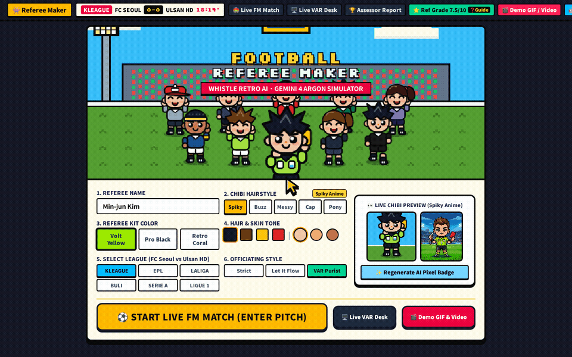

# ⚽ WHISTLE — AI Football Referee Simulator & Live VAR Desk



> 🌐 **Live Google Cloud Run App**: [https://referee-maker-281123354147.asia-east1.run.app](https://referee-maker-281123354147.asia-east1.run.app)
>
> 🎬 **Demo Video & Animated GIF (With Visible Mouse Clicks)**:
> - **Animated Gameplay GIF (Embedded Above)**: [`./public/demo-gameplay.gif`](./public/demo-gameplay.gif)
> - **Full HD MP4 Demo Video (For YouTube / Google Drive)**: [`./public/demo-gameplay.mp4`](./public/demo-gameplay.mp4)
> - 💡 *You can also click the **"🎬 Demo GIF / Video"** button in the top navigation bar inside the app to preview and download both files with one click.*

---

## 🏆 Hackathon Submission — Project Overview (English & 한국어)

### 🇬🇧 English Overview
**WHISTLE (Football Referee Maker)** is an interactive 16-bit retro pixel-art football referee simulator and live Video Assistant Referee (VAR) desk powered by the **Google Gemini API (`@google/genai`)**, grounded in the **IFAB Laws of the Game (Law 5, Law 12, Law 14)**, and deployed on **Google Cloud Run**.

Instead of controlling the footballers, you step onto the pitch as the **Match Referee**—blowing the metal pea-whistle, signaling advantage on 3v2 breakaways, brandishing yellow/red cards, and reviewing controversial calls at the pitchside **VAR On-Field Review (OFR)** monitor.

### 🇰🇷 프로젝트 소개 (Korean Overview)
**WHISTLE (Football Referee Maker)**은 22명의 선수가 실시간으로 움직이는 16비트 레트로 픽셀 경기장 위에서 **축구 주심(Referee)**이 되어 결정적인 판정(DOGSO 퇴장, 어드밴티지, 시뮬레이션 다이빙, 핸드볼 PK, 전술적 파울)을 내리고 **VAR 온필드 리뷰(OFR)**를 경험하는 AI 축구 심판 시뮬레이터입니다.

- **커스텀 심판 메이커 & 3대 리그**: K리그 1, 프리미어리그, 라리가 선택 및 나만의 도트 심판 캐릭터(유니폼, 헤어스타일 5종, 피부색, 판정 성향) 커스터마이징
- **실시간 22인 전술 피치 & 클로즈업 캠**: 백태클 발목 충돌(`SLIDE TACKLE` & `TRIPPED`), 노컨택 시뮬레이션 다이빙(`1.4m ZERO CONTACT`), 3대2 역습 스루패스, 95° 팔 벌림 핸드볼 등 실시간 애니메이션
- **깔끔한 `[-]` / `[+]` HUD 접기/펼치기 토글**: 카메라 모드(`🎥 CAM`), 줌(`🔍+`/`🔎-`), 재생 속도(`⏩ SPEED 0.5x~2x`), 클로즈업 캠(`Close-Up`), 상단 상황판, 우측 스탯 미터, 하단 판정 카드를 언제든 `[-]` / `[+]` 버튼으로 숨기거나 펼칠 수 있는 깔끔한 UI
- **스포일러 없는 2단계 판정 & VAR 온필드 리뷰(OFR)**: 공격수(`🔴 Attacker`)/수비수(`🔵 Defender`) 타겟 지정 후 5가지 판정 수행, 감독/주장 항의 음성(TTS) 및 IFAB 공식 경기규칙 기반 AI 판정 리포트 제공

---

## 🎥 What the Demo GIF / Video Shows (With Mouse Click Highlights)

Every user interaction in [`./public/demo-gameplay.gif`](./public/demo-gameplay.gif) and [`./public/demo-gameplay.mp4`](./public/demo-gameplay.mp4) displays a **red target cursor and click ripple** (`CLICK!`) so viewers can clearly see every button clicked:

| Scene | Match Moment | What Happens on Screen |
| :--- | :--- | :--- |
| **Scene 1** | **Custom Chibi Referee Maker** | Clicks through jersey colors, 5 anime/chibi hairstyles (`Spiky`, `Buzz + Headband`, `Curly Perm`, `Pro Cap`, `High Ponytail`), league selector, and clicks **`⚽ Enter Pitch — Kick Off Match`** |
| **Scene 2** | **Play 1 (18’ · 0-0): 1v1 Box Slide Tackle & Trip** | Striker `#9` sprints 1v1 into the box while Defender `#4` lunges from behind in a ground slide tackle that clips `#9`’s ankle (`💥`) and trips him forward. Cursor clicks **`🔵 Def #4`** inside **`[4] RED CARD`** → **Spot-On Decision (`+0.6` boost, `7.5 → 8.1/10`)** under **IFAB Law 12 §3 (DOGSO)** |
| **Scene 3** | **Play 2 (37’ · 1-0): Midfield 3v2 Advantage** | Midfielder `#8` trips `#10` at the halfway line just as the ball rolls to winger `#7` on a 3v2 counter-attack. Cursor clicks **`⚡ Advantage`** on **`[1] PLAY ON`** under **IFAB Law 5 §3** |
| **Scene 4** | **Play 3 (58’ · 1-2): Simulation Dive & VAR Review** | Defender `#19` pulls his boot back `1.4m` away (`1.4m NO CONTACT`), yet Attacker `#11` launches into a swan dive. Cursor clicks an initial foul call → triggers **Touchline Dissent Cut-In** + **Unspoiled VAR On-Field Review (OFR)** → clicks **`🔄 Overturn: Yellow Card → 🔴 Attacker #11`** |
| **Scene 5** | **Play 4 (76’ · 2-3): 95° Outstretched-Arm Handball** | Shooter `#10` fires a shot on target blocked by Defender `#20`’s `95°` outstretched arm inside the penalty area. Cursor clicks **`🎯 Award Penalty Kick`** on **`[5] PENALTY KICK`** |
| **Scene 6** | **Official FIFA/KFA Match Assessor Report** | Cursor opens **`🏆 Assessor Report`** showing full match accuracy, VAR overturn record, IFAB Law citations, and final career rating (`1.0 – 10.0`) |

---

## ✨ Key Technical Features

1. **Custom 2D Pixel-Art Pitch & Sprite Engine (`TacticalPitchCanvas.tsx` & `RetroPixelRenderer.ts`)**:
   - Real-time 60 FPS HTML5 Canvas rendering 22 players, custom referee, stadium crowd, mowed grass patterns, and an **Action Close-Up Cam** inset.
   - Purpose-built sprite poses for upright sprinting, leaning-back ground slide tackles with forward leg lunges and turf spray, swept-leg forward ankle trips, mid-air swan dives, 95° outstretched-arm handball blocks, and two-handed jersey grabs.
   - Collapsible **`[-]` / `[+]` HUD Controls** for Camera Mode (`Overview` / `Follow Ball`), Zoom (`🔍+` / `🔎-`), Playback Speed (`0.5x`–`2.0x`), `Close-Up Cam`, Situation Info, and Referee Status Meters.
2. **Spoiler-Free Two-Step Referee Decision HUD (`App.tsx`)**:
   - Explicitly target either **`🔴 Attacker`** or **`🔵 Defender`** and choose from 5 referee calls (`[1] Play On / Advantage`, `[2] Blow Whistle (Foul)`, `[3] Yellow Card`, `[4] Red Card`, `[5] Penalty Kick`) with custom SVG metal pea-whistle iconography.
   - Unspoiled **VAR On-Field Review (OFR)** modal where all review options share uniform neutral styling and reveal the rating delta (`+0.6` boost to `-0.9` penalty) only *after* your final decision.
3. **Multi-Agent Google Gemini Backend (`server.ts`)**:
   - **Loop 1 (Scenario Director + IFAB Auditor)**: Generates new match incidents with `@google/genai` and validates spatial coordinates and IFAB Law references (`confidence >= 0.85`).
   - **Loop 2 (Live IFAB Legal Analyst)**: Evaluates the referee's initial call, target player, and final VAR ruling against IFAB Law 5, Law 12, and Law 14.
   - **Gemini TTS Voice Dissent**: Synthesizes touchline coach and captain protests into spoken audio.
   - **Multimodal Live VAR Desk (`LiveVideoVarDesk.tsx`)**: Upload any real football video clip (`.mp4`/`.webm`) or frame for Gemini VAR analysis.

---

## 🚀 How to Run Locally or Export to Antigravity / GitHub

### 1. Sync to GitHub or Download ZIP from Google AI Studio
- To push the latest changes from AI Studio to your GitHub repository, click the **GitHub icon ("Save to GitHub" / "Sync to GitHub")** in the **top-right toolbar** of Google AI Studio.
- Or click **Download ZIP** in the top-right toolbar and open the folder in **Antigravity** or VS Code.

### 2. Configure Environment Variables
```bash
cp .env.example .env
```
Set your `GEMINI_API_KEY` inside `.env`:
```env
GEMINI_API_KEY="YOUR_GEMINI_API_KEY"
```

### 3. Install, Test & Start
```bash
npm install
npm test
npm run dev
```
- Open **`http://localhost:3000`** in your browser.
- Production build & start (Google Cloud Run):
  ```bash
  npm run build
  npm start
  ```

---

## 📂 Repository Structure

```text
├── README.md                              # Bilingual Project Overview, Embedded Demo GIF, & Setup Guide
├── public/
│   ├── demo-gameplay.gif                  # Animated gameplay GIF with visible mouse clicks & cursor
│   └── demo-gameplay.mp4                  # Full HD MP4 Demo Video with visible mouse clicks & cursor
├── package.json                           # Scripts (dev, build, start, test, lint) & dependencies
├── server.ts                              # Express + @google/genai backend routes (Cloud Run ready)
├── index.html                             # Entry point & OpenGraph/SEO metadata
└── src/
    ├── App.tsx                            # Referee HUD, [-] / [+] toggles, Target selector, & Unspoiled VAR OFR
    ├── components/
    │   ├── RetroRefereeMakerStage.tsx     # Step 1: Chibi Referee Maker, League & Archetype Lobby
    │   ├── TacticalPitchCanvas.tsx        # 2D Retro Pixel Pitch Engine, Close-Up Cam, & Collapsible Cam/Speed HUD
    │   ├── RetroPixelRenderer.ts          # Custom 2D sprite renderer (5 hairstyles, slide tackles, trips, dives)
    │   ├── LiveVideoVarDesk.tsx           # Multimodal video upload VAR analyzer
    │   └── AssessorReportView.tsx         # Post-match FIFA/KFA Assessor Report & Career Verdict
    ├── game/
    │   ├── rules.ts                       # Deterministic IFAB Law 5 & Law 12 evaluation engine & rating math
    │   ├── scenarios.ts                   # 5 verified derby scenarios (DOGSO, Advantage, Dive, Handball, SPA)
    │   └── rules.test.ts                  # Automated unit tests for IFAB evaluation & VAR OFR logic
    └── utils/
        └── soundEngine.ts                 # Web Audio API pea-whistle, card brandish, & VAR alert synthesizer
```
